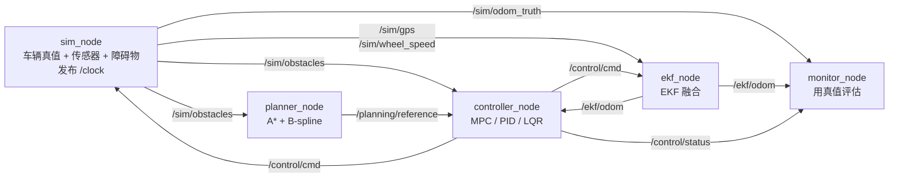

# ROS2 版本

把规划、估计、控制拆成独立的 ROS2 节点，基于 topic 通信，一条 launch 命令统一启动，
RViz2 实时显示参考轨迹与 MPC 预测时域。

节点里不复制算法代码，直接 import 仓库根目录下的 `core/`、`controllers/`、`estimation/`、
`planning/`、`obstacles/`、`scenarios.py`，所以离线版和 ROS2 版始终是同一份算法。

## 环境

- Windows 11 + WSL2（Ubuntu 24.04）+ ROS2 Jazzy（desktop 版，含 RViz2）
- 额外的系统包：`sudo apt install ros-jazzy-ackermann-msgs python3.12-venv`
- cvxpy 装在虚拟环境 `~/mpc_ws/.venv` 里，第一次运行脚本时会自动创建。
  numpy 刻意沿用系统自带的 1.26：ROS 的 Python 消息模块是按 numpy 1.x 编译的，换成 numpy 2.x 会导入失败。

## 运行

**Windows**：双击 `ros2/start_pipeline.bat`，或在 PowerShell / CMD 里进入仓库的 `ros2` 目录后运行：

```bat
.\start_pipeline.bat
.\start_pipeline.bat scenario:=oncoming
```

脚本会通过 WSL 在 Ubuntu 里编译（没有改动时几秒就结束）并启动所有节点，RViz2 窗口直接弹到 Windows 桌面上。
关掉 RViz 窗口或在终端按 Ctrl+C 即可结束。脚本默认使用名为 `Ubuntu-24.04` 的 WSL 发行版，不同的话改 `.bat` 里的 `DISTRO`。

**Ubuntu 终端**（原生 Ubuntu 或 WSL 都可以；在 WSL 里，Windows 的 `D:\code\MPC` 对应 `/mnt/d/code/MPC`）：

```bash
cd /path/to/MPC                       # 换成你的仓库路径
bash ros2/scripts/run.sh              # 编译 + 启动
bash ros2/scripts/run.sh scenario:=oncoming

# 或者分步执行
bash ros2/scripts/build.sh
source ~/mpc_ws/install/setup.bash
ros2 launch mpc_tracking full_pipeline.launch.py
```

源码留在仓库里，编译产物放在 Ubuntu 的 `~/mpc_ws`（Linux 文件系统，更快）。
用的是 `--symlink-install`，改 Python / launch / yaml / rviz 文件后不需要重新编译，重启即可。

### launch 参数

| 参数 | 默认值 | 说明 |
|---|---|---|
| `scenario` | `astar` | 场景：`astar` / `line` / `circle` / `lane` / `accel_brake` / `serpentine` / `block` / `oncoming` / `crossing` |
| `controller` | `mpc` | 控制器：`mpc` / `pid` / `lqr` |
| `use_ekf` | `true` | `true`：控制器用 EKF 估计；`false`：直接用真值 |
| `mpc_avoid` | `true` | MPC 是否加避障约束（场景里有障碍时才起作用） |
| `real_time_factor` | `1.0` | 仿真速度：`1.0` 实时，`0.5` 慢放，`0` 尽快跑完 |
| `rviz` | `true` | 是否打开 RViz2 |
| `exit_on_finish` | `false` | 车到终点、打印完指标后自动退出 |

其它参数（传感器噪声、A* 地图、EKF 初值、MPC 预测步数等）在 [`config/pipeline.yaml`](mpc_tracking/config/pipeline.yaml)。

不开 RViz、全速跑一遍并打印指标（约 7 秒）：

```bash
ros2 launch mpc_tracking full_pipeline.launch.py rviz:=false real_time_factor:=0 exit_on_finish:=true
```

## 节点与话题



| 节点 | 作用 | 复用的算法 |
|---|---|---|
| `sim_node` | 代替真车：推进车辆真值、模拟 GPS（5 Hz）和轮速（10 Hz）、推进动态障碍；发布仿真时钟 `/clock` | `VehicleModel`、`SensorSuite`、障碍物类 |
| `planner_node` | `astar` 场景：用障碍物建栅格 → A* → B-spline 平滑 → 等弧长重采样；其它场景直接发布场景自带的参考轨迹 | `OccupancyGrid`、`astar`、`smooth_path`、`ReferenceTrajectory` |
| `ekf_node` | 融合 GPS 和轮速，发布状态估计（带协方差） | `ExtendedKalmanFilter` |
| `controller_node` | 每收到一次状态就求解一次，发布控制指令、MPC 预测轨迹、参考窗口 | `MPCController` / `PIDController` / `LQRController` |
| `monitor_node` | 只订阅不控制：用真值算跟踪误差，到终点时打印与 `main.py` 同口径的指标 | `viz.plot.compute_errors` |

| 话题 | 类型 | 说明 |
|---|---|---|
| `/control/cmd` | `ackermann_msgs/AckermannDriveStamped` | 控制量：`acceleration` = a，`steering_angle` = δ |
| `/ekf/odom` | `nav_msgs/Odometry` | EKF 估计（带协方差） |
| `/sim/odom_truth` | `nav_msgs/Odometry` | 车辆真值 |
| `/sim/gps` | `geometry_msgs/PoseWithCovarianceStamped` | GPS 位置测量 |
| `/sim/wheel_speed` | `geometry_msgs/TwistWithCovarianceStamped` | 轮速测量 |
| `/sim/obstacles` | `mpc_tracking_interfaces/ObstacleArray` | 障碍物（位置、速度、半径） |
| `/planning/reference` | `mpc_tracking_interfaces/ReferenceTrajectory` | 参考轨迹（含速度和曲率，`nav_msgs/Path` 装不下） |
| `/planning/path` | `nav_msgs/Path` | 参考轨迹（给 RViz） |
| `/control/mpc_prediction` | `nav_msgs/Path` | MPC 预测时域（N+1 个点） |
| `/control/reference_window` | `nav_msgs/Path` | MPC 当前跟踪的参考窗口 |
| `/control/status` | `mpc_tracking_interfaces/ControllerStatus` | 求解状态、耗时、最近点索引 |

自定义消息定义在 [`mpc_tracking_interfaces/msg`](mpc_tracking_interfaces/msg)。

## RViz2 里能看到

- 灰色方块：A* 用的膨胀栅格；灰色方框：规划区域
- 红色圆柱：障碍物；浅橙色圆盘：MPC 避障约束用的安全半径；黄色箭头：动态障碍的速度
- 绿色粗线：参考轨迹；灰色细线：A* 原始折线
- **红色线：MPC 预测时域**；黄色线：MPC 当前跟踪的参考窗口
- 蓝色方块和蓝线：车辆真值和走过的轨迹
- 紫色箭头和椭圆：EKF 估计位姿和 2σ 位置不确定性

## 设计要点

- **仿真节点是时钟源。** 它发布 `/clock`，其它节点都用 `use_sim_time`，所有消息的时间戳都是仿真时间 `k·dt`。
- **lockstep 推进。** 仿真节点推进第 k+1 步之前，先等"基于第 k 步状态算出的控制指令"（指令时间戳 = 所用状态的时间戳）。
  这样闭环结果与求解耗时、进程调度无关，每次运行都一样，能和离线仿真逐步对比。
- **控制由状态触发。** 控制器不自己开定时器，每收到一次状态估计就算一次，避免两个定时器相位不同多出一拍延迟。
- **EKF 以轮速为节拍。** 测量带时间戳，先 predict 到该时刻（用这段时间实际生效的控制指令）再 update。
  轮速每拍都有，处理完轮速就发布估计；同一拍里仿真节点先发 GPS 再发轮速，所以发布时这一拍的测量都已用上。
- **QoS。** 参考轨迹、地图、障碍物用"锁存"（transient local），晚启动的节点也能拿到；传感器、状态、指令用普通的可靠传输。

## 与离线仿真的对比

同一台机器上分别运行 `python main.py ...` 和 ROS2 版（`real_time_factor:=0 exit_on_finish:=true`）：

| 场景 | 离线 `main.py` | ROS2 |
|---|---|---|
| `astar` + EKF + MPC 避障 | 154 步到达；横向 RMS 0.226 m，max 0.504 m；航向 RMS 7.02°；EKF 位置 RMS x 0.173 m / y 0.229 m；求解失败 5 拍 | 相同 |
| `oncoming` 动态障碍 + EKF | 107 步；横向 RMS 0.716 m，max 2.663 m | 相同 |
| `astar` + PID（真值） | 144 步；横向 RMS 0.125 m | 相同 |
| `lane` / `serpentine`（真值） | 85 / 109 步；横向 RMS 0.077 / 0.082 m（与 `baseline_metrics.json` 一致） | 相同 |
| `circle` + EKF | 3000 步仍未到达（航向 RMS 89.6°） | 168 步到达；横向 RMS 0.591 m |

"相同"指步数一致、各项指标的差异小于 1e-5（例如 `astar` + EKF 的横向 RMS 差 5e-9 m）。
差异来自控制指令消息：`AckermannDriveStamped` 的字段是 float32，比离线版的 float64 多一点舍入误差。

`circle` + EKF 的差异来自航向角：EKF 把航向折回 [-π, π]，而圆轨迹的参考航向一路累加到 2.5π，
离线版 MPC 看到的航向误差接近 2π。ROS2 控制节点在差值超过 π 时把状态航向整圈平移到参考航向附近；
其它场景不会触发这个处理，数值不受影响。

## 调试常用命令

```bash
ros2 node list
ros2 topic list
ros2 topic hz /control/cmd             # 实时运行时约 10 Hz
ros2 topic echo /control/status        # 每拍的求解状态、耗时、进度
ros2 topic echo /ekf/odom --once
rqt_graph                              # 节点 / 话题关系图
```

## 文件结构

```
ros2/
├── start_pipeline.bat              # Windows 一键启动
├── scripts/
│   ├── run.sh                      # 编译 + 启动 (参数透传给 ros2 launch)
│   ├── build.sh                    # colcon build 到 ~/mpc_ws
│   └── setup_venv.sh               # 建虚拟环境、装 cvxpy
├── mpc_tracking_interfaces/        # 自定义消息 (ament_cmake)
│   └── msg/  Obstacle / ObstacleArray / ReferenceTrajectory / ControllerStatus
└── mpc_tracking/                   # 节点 (ament_python)
    ├── mpc_tracking/
    │   ├── sim_node.py  planner_node.py  ekf_node.py  controller_node.py  monitor_node.py
    │   ├── common.py               # QoS、时间戳、消息转换、节点启动
    │   ├── _paths.py               # 让节点能 import 仓库根目录下的算法模块
    │   └── sigint_guard.py         # OSQP 求解时 Ctrl+C 不被吞掉
    ├── launch/full_pipeline.launch.py
    ├── config/pipeline.yaml
    └── rviz/pipeline.rviz
```

## 已知限制

- 只做了仿真闭环，没有接真车或 Gazebo；`sim_node` 用的是和离线版相同的运动学模型。
- 规划只在启动时做一次，障碍物变化或新目标点不会触发重规划。
- 没有 rosbag 录制 / 回放脚本（需要的话可以直接用 `ros2 bag record -a`）。
- WSLg 下 RViz 的 Map 显示项可能显示不出来（着色器链接失败），所以栅格默认改用 Marker 方块显示。
